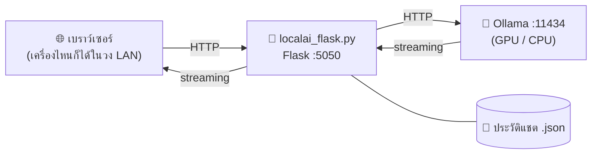

# 🦙 Local AI Chat • Ollama

เว็บแอปแชตกับ AI ที่รันบนเครื่องของคุณเองผ่าน [Ollama](https://ollama.com)
**ไฟล์เดียวจบ** (`localai_flask.py`) ไม่ต้องสมัครสมาชิก ไม่มีค่าใช้จ่าย และข้อมูลไม่ถูกส่งออกอินเทอร์เน็ต

> Developed by **[Uncle Engineer](https://uncle-engineer.com/)**

---

## ✨ ความสามารถ

- 💬 **แชตแบบ Streaming** เห็นคำตอบทีละคำแบบเดียวกับ ChatGPT
- 🧠 **เลือกโมเดลได้** ดึงรายชื่อโมเดลที่ติดตั้งใน Ollama มาให้อัตโนมัติ
- 📎 **แนบไฟล์ให้ AI วิเคราะห์**
  - รูปภาพ (ใช้กับโมเดลที่ดูรูปได้ เช่น `gemma3`, `qwen2.5vl`, `qwen3.5`)
  - Excel (`.xlsx` `.xlsm` `.xls`), CSV, Word (`.docx`), PowerPoint (`.pptx`), PDF
  - ไฟล์ข้อความ, โค้ด และ G-code (`.nc` `.tap` `.gcode`)
  - ลากไฟล์มาวาง หรือกด `Ctrl + V` เพื่อวางรูปได้ทันที
- 🎨 **โค้ดแสดงเป็นสี** รองรับ Python, JavaScript, C/C++, SQL, HTML, CSS, Shell, JSON
  รวมถึง **G-code (Fanuc)** และ **Heidenhain Klartext**
- 📝 **แสดงผล Markdown** ทั้งหัวข้อ ลิสต์ ตาราง ลิงก์ และโค้ดบล็อก พร้อมปุ่มคัดลอก
- 💭 **โหมด Thinking** ดูขั้นตอนการคิดของโมเดลที่รองรับ (พับ/ขยายได้)
- 🗂️ **ประวัติแชต** ค้นหา เปลี่ยนชื่อ ลบ และส่งออกเป็นไฟล์ `.md`
- 🌐 **ใช้ร่วมกันในวง LAN** เครื่องอื่นในออฟฟิศเปิดผ่านเบราว์เซอร์ได้เลย โดยไม่ต้องติดตั้งอะไร
- 📱 **รองรับมือถือและแท็บเล็ต** (Responsive)
- ❓ **มีคู่มือในตัว** กดปุ่ม `?` มุมขวาบนเพื่อดูวิธีติดตั้ง Ollama และวิธีเลือกโมเดล
- ⚡ **เบาและออฟไลน์ 100%** ไม่โหลดอะไรจาก CDN

---

## 📋 สิ่งที่ต้องมี

| รายการ | หมายเหตุ |
|---|---|
| [Python](https://www.python.org/downloads/) 3.9 ขึ้นไป | Windows: ตอนติดตั้งต้องติ๊ก ☑ **Add python.exe to PATH** |
| [Ollama](https://ollama.com/download) | ตัวประมวลผล AI ที่รันในเครื่อง |
| โมเดล AI อย่างน้อย 1 ตัว | ดาวน์โหลดผ่านแอป Ollama (ดูขั้นที่ 3) |

---

## 🚀 วิธีติดตั้ง

### ขั้นที่ 1: ดาวน์โหลดโปรเจกต์

```bash
git clone https://github.com/UncleLabsBlacksmith/LocalAI_Flask.git
cd LocalAI_Flask
```

หรือกดปุ่ม **Code → Download ZIP** แล้วแตกไฟล์

> 💡 คำสั่ง `git clone` ต้องพิมพ์ใน cmd / Terminal และจะสร้างโฟลเดอร์ `LocalAI_Flask` ไว้ในโฟลเดอร์ที่เปิดอยู่ตอนนั้น
>
> 💡 ถ้าดาวน์โหลดเป็น ZIP โฟลเดอร์ที่แตกออกมาจะชื่อ `LocalAI_Flask-main` ให้ใช้ชื่อนี้แทนในขั้น `cd` ตอนรัน

### ขั้นที่ 2: ติดตั้งไลบรารี Python

เปิด **cmd** (Windows) หรือ **Terminal** (macOS) แล้วพิมพ์:

```bash
pip install flask
pip install openpyxl python-docx python-pptx pypdf xlrd
```

| ไลบรารี | ใช้ทำอะไร | จำเป็น? |
|---|---|---|
| `flask` | รันเว็บแอป | ✅ จำเป็น |
| `openpyxl` | อ่าน Excel `.xlsx` | แนบไฟล์ Excel |
| `xlrd` | อ่าน Excel `.xls` (รุ่นเก่า) | แนบไฟล์ Excel รุ่นเก่า |
| `python-docx` | อ่าน Word `.docx` | แนบไฟล์ Word |
| `python-pptx` | อ่าน PowerPoint `.pptx` | แนบไฟล์ PowerPoint |
| `pypdf` | อ่าน PDF | แนบไฟล์ PDF |

> 💡 macOS ใช้ `pip3` แทน `pip`
>
> 💡 ถ้าขึ้นว่า `'pip' is not recognized` ให้ใช้ `python -m pip install flask` แทน

### ขั้นที่ 3: ติดตั้ง Ollama และดาวน์โหลดโมเดล

1. ดาวน์โหลดและติดตั้ง Ollama จาก [ollama.com/download](https://ollama.com/download)
2. เปิดแอป **Ollama** แล้วเลือกโมเดลจากรายการในช่องพิมพ์ (ดูตารางแนะนำด้านล่าง)
3. พิมพ์ `hello` แล้วกด Enter ครั้งแรก Ollama จะดาวน์โหลดโมเดลให้อัตโนมัติ
4. ถ้า AI ตอบกลับมาได้ แปลว่าพร้อมใช้งาน 🎉

หรือดาวน์โหลดผ่านคำสั่ง:

```bash
ollama pull qwen3:8b
```

---

## ▶️ วิธีรัน

ทำตามนี้ทุกครั้งที่ต้องการใช้งาน

### 1. เปิด Ollama ให้ทำงานก่อน

เปิดแอป **Ollama** แล้วสังเกตว่ามีไอคอน 🦙 ที่มุมขวาล่างของ Windows (ข้างนาฬิกา) หรือแถบเมนูด้านบนของ macOS

### 2. เปิด cmd / Terminal ในโฟลเดอร์ที่มีไฟล์ `localai_flask.py`

ต้องเปิดหน้าต่างพิมพ์คำสั่ง**ในโฟลเดอร์ที่เก็บไฟล์ `localai_flask.py`** ไม่อย่างนั้นจะขึ้น error ว่าหาไฟล์ไม่เจอ (`No such file or directory`)

**Windows (วิธีง่ายสุด)**

1. เปิดโฟลเดอร์ที่มีไฟล์ `localai_flask.py` ใน File Explorer
2. คลิกที่ช่องที่อยู่ (address bar) ด้านบน ที่แสดงเช่น `This PC > Downloads > LocalAI_Flask`
3. ลบข้อความเดิมออก พิมพ์ `cmd` แล้วกด Enter
4. จะได้หน้าต่าง cmd ที่อยู่ในโฟลเดอร์นั้นทันที

**Windows (ใช้คำสั่ง cd)**

1. กดปุ่ม Windows พิมพ์ `cmd` แล้วกด Enter
2. พิมพ์ `cd` ตามด้วยตำแหน่งโฟลเดอร์ เช่น ถ้าเก็บไว้ใน Downloads:

```bat
cd %USERPROFILE%\Downloads\LocalAI_Flask
```

> 💡 ไม่แน่ใจว่าโฟลเดอร์อยู่ที่ไหน: พิมพ์ `cd ` (มีเว้นวรรค) แล้ว**ลากโฟลเดอร์มาวางในหน้าต่าง cmd** ระบบจะใส่ตำแหน่งให้เอง จากนั้นกด Enter
>
> 💡 ถ้าโฟลเดอร์อยู่คนละไดรฟ์ เช่น `D:` ให้ใช้ `cd /d D:\Projects\LocalAI_Flask`

**macOS**

1. กด `Command + Space` พิมพ์ `Terminal` แล้วกด Enter
2. พิมพ์ `cd ` (มีเว้นวรรค) แล้วลากโฟลเดอร์มาวางในหน้าต่าง Terminal แล้วกด Enter หรือพิมพ์เอง เช่น:

```bash
cd ~/Downloads/LocalAI_Flask
```

**เช็กว่าอยู่ถูกโฟลเดอร์แล้ว** ให้พิมพ์ `dir` (Windows) หรือ `ls` (macOS) ต้องเห็นไฟล์ `localai_flask.py` ในรายการ

### 3. รันโปรแกรม

```bash
python localai_flask.py
```

> macOS ใช้ `python3 localai_flask.py`

ถ้ารันสำเร็จ จะแสดงข้อความแบบนี้:

```
Local AI Chat • Ollama
  ข้อมูลแชต: C:\Users\you\.local_ai_ollama_chat.json
  เครื่องนี้:      http://127.0.0.1:5050
  เครื่องอื่นในวง: http://192.168.1.50:5050
```

> ⚠️ **อย่าปิดหน้าต่าง cmd / Terminal นี้ระหว่างใช้งาน** ถ้าปิด เว็บจะหยุดทำงานทันที

### 4. เปิดเบราว์เซอร์

- เครื่องนี้: เปิด **http://127.0.0.1:5050**
- เครื่องอื่นในวง LAN: เปิด URL ในบรรทัด "เครื่องอื่นในวง" ที่โปรแกรมแสดง

### 5. ปิดโปรแกรม

กลับไปที่หน้าต่าง cmd / Terminal แล้วกด `Ctrl + C`

---

## 🧠 เลือกโมเดลให้เหมาะกับเครื่อง

ดูหน่วยความจำการ์ดจอ (VRAM) ได้ที่ **Task Manager → Performance → GPU → Dedicated GPU memory**
ถ้าเป็น Mac ชิป M ให้ใช้ประมาณ 2 ใน 3 ของ RAM ทั้งหมด

| VRAM | โมเดลที่แนะนำ | เหมาะกับ |
|---|---|---|
| ไม่มีการ์ดจอ / ไม่เกิน 4 GB | `qwen3.5:2b` | ถาม-ตอบสั้นๆ, ทดลองใช้ |
| 6 – 8 GB | `qwen3:8b`, `gemma3:4b` | ใช้งานทั่วไป ภาษาไทยดี |
| 12 – 16 GB | `qwen3:14b`, `gemma3:12b` | สรุปเอกสาร วิเคราะห์ตาราง |
| 24 GB ขึ้นไป | `qwen3.5:27b`, `gemma3:27b` | คุณภาพสูงสุดในเครื่องเดียว |

**เลือกตามประเภทงาน**

- 👨‍💻 **เขียนโค้ด:** `qwen2.5-coder:7b` (8 GB) หรือ `qwen3-coder:30b` (24 GB)
- 🖼️ **วิเคราะห์รูปภาพ / OCR:** `gemma3`, `qwen2.5vl`, `qwen3.5`
- 💭 **คิดเป็นขั้นตอน:** `qwen3`, `deepseek-r1` (เปิดโหมด Thinking ใน ⚙ ตั้งค่า)

> ⚠️ ขนาดไฟล์โมเดลควรเล็กกว่า VRAM ประมาณ 1–2 GB ถ้าใหญ่เกิน โปรแกรมยังทำงานได้แต่จะช้าลงมาก
>
> ⚠️ โมเดลที่ลงท้ายด้วย `cloud` จะประมวลผลบนเซิร์ฟเวอร์ ไม่ใช่ในเครื่อง ถ้าต้องการความเป็นส่วนตัวให้เลือกตัวที่ไม่มีคำนี้

---

## ⚙️ การตั้งค่า

### ในหน้าเว็บ (ปุ่ม ⚙ ตั้งค่า)

| ค่า | ค่าเริ่มต้น | คำอธิบาย |
|---|---|---|
| Ollama Host | `http://localhost:11434` | ที่อยู่ของ Ollama (จำกัดไว้เฉพาะ localhost เพื่อความปลอดภัย) |
| System Prompt | (ว่าง) | กำหนดบทบาท AI เช่น "คุณคือวิศวกรงานกลึง ตอบเป็นภาษาไทย" |
| Temperature | `0.7` | ต่ำ = ตอบตรงๆ คงที่ / สูง = สร้างสรรค์มากขึ้น |
| Context Window | `8192` | จำนวน token ที่ AI อ่านได้ต่อครั้ง **แนบไฟล์ใหญ่ควรเพิ่มเป็น 16384–32768** |
| ข้อความย้อนหลัง | `20` | จำนวนข้อความเก่าที่ส่งให้ AI ทุกครั้ง (0 = ทั้งหมด) |
| โหมด Thinking | ปิด | แสดงขั้นตอนการคิดสำหรับโมเดลที่รองรับ |

### Environment Variables

| ตัวแปร | ค่าเริ่มต้น | คำอธิบาย |
|---|---|---|
| `LOCALAI_PORT` | `5050` | พอร์ตของเว็บ |
| `LOCALAI_HOST` | `0.0.0.0` | `0.0.0.0` = เปิดให้เครื่องในวง LAN เข้าได้ / `127.0.0.1` = เฉพาะเครื่องนี้ |
| `LOCALAI_DATA` | `~/.local_ai_ollama_chat.json` | ตำแหน่งไฟล์เก็บประวัติแชต |

ตัวอย่าง (Windows):

```bat
set LOCALAI_HOST=127.0.0.1
set LOCALAI_PORT=8080
python localai_flask.py
```

ตัวอย่าง (macOS / Linux):

```bash
LOCALAI_HOST=127.0.0.1 LOCALAI_PORT=8080 python3 localai_flask.py
```

---

## ⌨️ คีย์ลัด

| คีย์ | การทำงาน |
|---|---|
| `Enter` | ส่งข้อความ |
| `Shift + Enter` | ขึ้นบรรทัดใหม่ |
| `Esc` | หยุดการตอบ |
| `Alt + N` | เริ่มแชตใหม่ |
| `Ctrl + V` | วางรูปภาพจากคลิปบอร์ด |

---

## 🔧 แก้ปัญหาที่พบบ่อย

| อาการ | วิธีแก้ |
|---|---|
| มุมซ้ายล่างเป็น 🔴 "เชื่อมต่อไม่ได้" | Ollama ยังไม่ได้เปิด ให้เปิดแอป Ollama แล้วกด ↻ |
| ขึ้นว่า "ยังไม่มีโมเดล" | ยังไม่ได้ดาวน์โหลดโมเดล ให้ทำขั้นที่ 3 |
| ตอบช้ามาก | โมเดลใหญ่เกินการ์ดจอ ให้เปลี่ยนเป็นรุ่นที่เล็กลง |
| แนบรูปแล้ว AI บอกว่ามองไม่เห็น | ต้องใช้โมเดลที่ดูรูปได้ เช่น `gemma3`, `qwen2.5vl` |
| วิเคราะห์ Excel แล้วข้อมูลไม่ครบ | เพิ่ม Context Window ใน ⚙ ตั้งค่า |
| แนบไฟล์แล้วขึ้น "ต้องติดตั้งไลบรารีเพิ่ม" | รันคำสั่ง `pip install` ตามที่ข้อความแจ้ง |
| PDF อ่านไม่ออก | อาจเป็นไฟล์สแกน ให้แปลงหน้าเป็นรูปแล้วแนบแทน |
| เครื่องอื่นเปิดหน้าเว็บไม่ได้ | อนุญาต Python หรือพอร์ต 5050 ใน Windows Firewall |
| `'python' is not recognized` | ติดตั้ง Python ใหม่โดยติ๊ก **Add python.exe to PATH** |

---

## 🏗️ โครงสร้างการทำงาน



- **Flask** ส่งหน้าเว็บ (HTML/CSS/JS ที่ฝังอยู่ในไฟล์เดียว) และเป็นตัวกลางส่งต่อไปยัง Ollama
- **ไฟล์แนบ:** รูปภาพจะถูกย่อในเบราว์เซอร์ก่อนส่งเป็น base64 ส่วนเอกสาร Flask จะแปลงเป็นข้อความแล้วแนบไปกับคำถาม
- **Ollama** ทำงานบนเครื่องที่รัน Flask เท่านั้น เครื่องอื่นในวง LAN ใช้แค่เบราว์เซอร์

---

## 🔒 ความปลอดภัย

- ทุกอย่างประมวลผลในเครื่อง ข้อมูลไม่ถูกส่งออกอินเทอร์เน็ต (ยกเว้นเลือกใช้โมเดลแบบ `cloud`)
- Server จะเชื่อมต่อ Ollama ได้เฉพาะ `localhost` / `127.0.0.1` เท่านั้น
- ⚠️ **ไม่มีระบบล็อกอิน** ทุกเครื่องในวง LAN เห็นและแก้ไขประวัติแชตชุดเดียวกันได้
  ควรใช้ในเครือข่ายที่ไว้ใจได้ และ **ห้ามเปิดพอร์ตนี้ออกอินเทอร์เน็ต**
  ถ้าต้องการใช้คนเดียว ให้ตั้ง `LOCALAI_HOST=127.0.0.1`

---

## 🙏 เครดิต

Developed by **[Uncle Engineer](https://uncle-engineer.com/)**

ขับเคลื่อนด้วย [Ollama](https://ollama.com) และ [Flask](https://flask.palletsprojects.com)

---

## 🎓 อยากสร้าง Local AI แบบนี้ได้เอง?

โปรเจกต์นี้เริ่มจากโปรแกรม Desktop (Tkinter) แล้วพัฒนาต่อเป็นเว็บแอป (Flask) ถ้าสนใจเรียนเทคนิคการสร้าง **Local AI** แบบนี้เพิ่มเติม สมัครเรียนได้ที่คอร์สนี้

### 👉 [Local AI 101 — สร้าง AI ส่วนตัวบนเครื่องของคุณเอง](https://uncle-engineer.com/course/local-ai-101/)

| | |
|---|---|
| 💰 **ราคา** | เพียง **990 บาท** (จากราคาปกติ 3,960 บาท) |
| ⏱️ **เนื้อหา** | เรียน **20 ชั่วโมง** (10 EP, EP ละ 2 ชั่วโมง) |
| 📺 **รูปแบบ** | เรียนออนไลน์ผ่านไลฟ์ ทุกวันพุธ 19.15 น. ต่อเนื่อง 10 สัปดาห์ |
| 👨‍🏫 **ผู้สอน** | Uncle Engineer — ลุงวิศวกร สอนคำนวณ |

**สิ่งที่จะได้เรียน**

- Local AI กับ Cloud AI ต่างกันอย่างไร และต้องใช้ฮาร์ดแวร์แบบไหน (CPU, GPU, RAM, VRAM)
- ติดตั้ง Ollama และเข้าใจ Parameters, Quantization, Context Length
- สร้าง Private ChatGPT ด้วย Open WebUI
- เชื่อมต่อ Local AI กับ Python ผ่าน API
- สร้าง **Desktop AI App ด้วย Tkinter** และ **Web AI App ด้วย Flask** (แบบโปรเจกต์นี้)
- RAG สำหรับคุยกับเอกสาร (Embedding, Vector Database)
- สร้าง Mobile AI App ด้วย Flutter และ Local AI Agent

### 🔗 [สมัครเรียนที่นี่ → uncle-engineer.com/course/local-ai-101](https://uncle-engineer.com/course/local-ai-101/)
